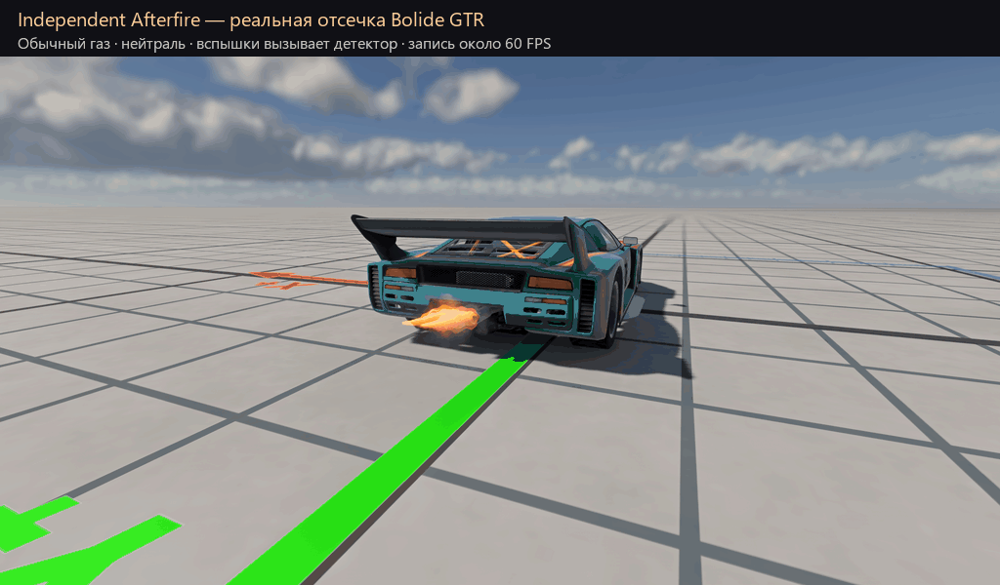

# Independent Afterfire for BeamNG.drive

An experimental, independently written exhaust-flame mod. This repository is an
early prototype, not a finished or repository-ready release.

The first milestone is a small event detector that responds to throttle lift,
gear changes and detected rev-limiter cuts. The prototype renders its own
procedurally generated, layered 3D flame meshes and textures. These are early
geometric approximations, not a ray-marched fluid simulation. The prototype does
not include assets or source from other mods. BeamNG.drive is required.

An auxiliary vehicle controller now captures rev-limiter cut edges after every
powertrain physics step. It reads engine state without wrapping engine functions,
modifying fuel queues, or enabling the global extension physics hook. Throttle
and gear inputs still come from the game's graphics-updated electrics values.
Short neutral phases during manual shifts are supported.
Different burst shapes are used for limiter, shift, and throttle-lift events.
The renderer reuses dynamic scene objects that track each outlet immediately
before rendering. This avoids treating moving flames as static scenery. It is
experimental and still needs testing on additional vehicles and frame rates.
Limiter burst length follows the measured cut interval to leave dark gaps.
Each outlet's configured visual coefficient attenuates flame size; disabled
outlets and outlets under water do not receive flames. A bounded mailbox keeps
the latest event per graphics frame and discards stale events. Multiple cuts
between rendered frames cannot all be shown as separate visible flashes.
The archive is experimental and has not been installed in the normal game.

## Development status

- Independent event detector and experimental layered 3D flame: in testing.
- Production-quality flame rendering, configuration interface and sound: unfinished.
- Exhaust heat: not implemented in this project.

The project is being tested in a separate game profile. Do not use the
experimental prototype alongside another afterfire mod: both may emit effects.
The current bootstrap targets the player vehicle and does not modify the
vehicle's JBeam parts.

## Development package

Run `python tools/package.py` to create `dist/independent_afterfire_dev.zip`.
The ZIP contains the runtime files only. Try this development build in a separate
BeamNG user profile with other afterfire mods disabled.

## Testing

See [tests/README.md](tests/README.md). Basic event-detector checks and
automatic attachment have been exercised in an isolated BeamNG 0.40.4 profile.
Physics-step limiter capture has been compared with graphics-only sampling at
30 and 60 FPS on Bolide, with stock and race ETK configurations also checked.
See [the validation notes](docs/validation-2026-11-04.md) for results and limits. The
recording below uses deliberately triggered test events in a stationary vehicle,
and shows the current unfinished prototype, not actual driving or synchronization.

The following isolated test uses an imposed initial velocity and manually
triggered bursts to check attachment to the moving vehicle. The speed in the
caption is measured in the game; motion blur was disabled for inspection.

The latest recording uses ordinary full-throttle input in neutral. Bursts are
generated by the detector from real engine cuts; no renderer events are forced.

