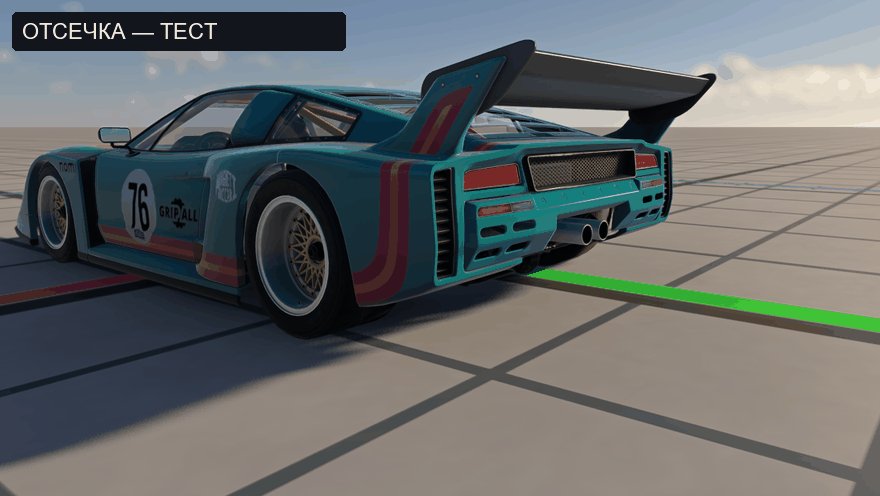
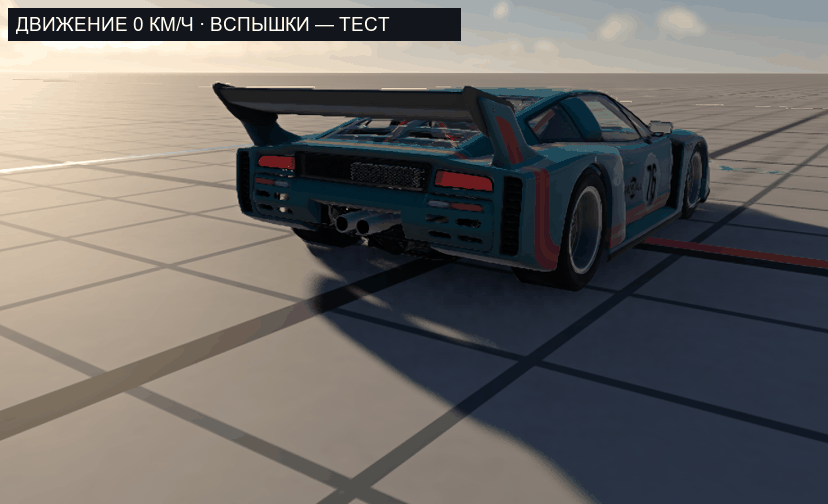

# Independent Afterfire for BeamNG.drive

An experimental, independently written exhaust-flame mod. This repository is an
early prototype, not a finished or repository-ready release.

The first milestone is a small event detector that responds to throttle lift,
gear changes and detected rev-limiter cuts. The prototype renders its own
procedurally generated, layered 3D flame meshes and textures. These are early
geometric approximations, not a ray-marched fluid simulation. The prototype does
not include assets or source from other mods. BeamNG.drive is required.

The current implementation samples vehicle state once per graphics update.
Short limiter cuts between updates can be missed; synchronization is unfinished.
Different burst shapes are used for limiter, shift, and throttle-lift events.
The renderer reuses dynamic scene objects that track each outlet immediately
before rendering. This avoids treating moving flames as static scenery. It is
experimental and still needs testing on additional vehicles and frame rates.
The archive is experimental and has not been installed in the normal game.

## Development status

- Independent event detector and experimental layered 3D flame: in testing.
- Production-quality flame rendering, configuration interface and sound: unfinished.
- Exhaust heat: not implemented in this project.

The project is being tested in a separate game profile. Do not use the
experimental prototype alongside another afterfire mod: both may emit effects.
The current bootstrap targets the player vehicle and does not modify the
vehicle's JBeam parts.

## Testing

See [tests/README.md](tests/README.md). Basic event-detector checks and
automatic attachment have been exercised in an isolated BeamNG 0.40.4 profile;
the visual result and real driving behavior still need further testing. The
recording below uses deliberately triggered test events in a stationary vehicle,
and shows the current unfinished prototype, not actual driving or synchronization.

The following isolated test uses an imposed initial velocity and manually
triggered bursts to check attachment to the moving vehicle. The speed in the
caption is measured in the game; motion blur was disabled for inspection.

